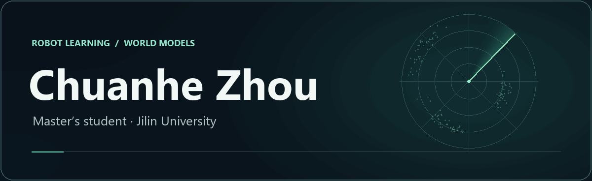

<picture>
  <source media="(prefers-reduced-motion: reduce)" srcset="assets/banner-still.png">
  
</picture>

I'm a master's student in the **School of Artificial Intelligence at Jilin University**. I'm interested in **robot learning** and **world models**, especially how robots can learn to predict the consequences of their actions. I previously studied **Applied Mathematics** at Harbin Engineering University.

[Academic website](https://chuan7one.github.io/) · [CV](https://chuan7one.github.io/cv/)

## RoboMaster projects

- [**Radar Station**](https://chuan7one.github.io/portfolio/radar-station/) — Monocular camera and LiDAR fusion for tracking robots and estimating their positions across the arena.
- [**Auto Aim**](https://chuan7one.github.io/portfolio/auto-aim/) — An extended Kalman filter uses a whole-robot motion model to track RoboMaster armor plates.

## Competition awards

| Year | RoboMaster award |
| :--- | :--- |
| 2026 | Third National Prize |
| 2025 | Second National Prize |
| 2024 | Second National Prize |
